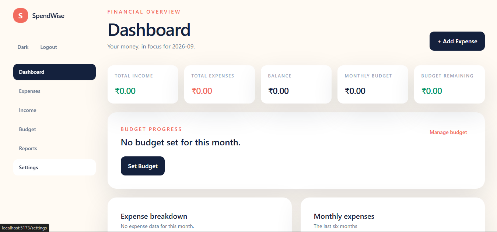
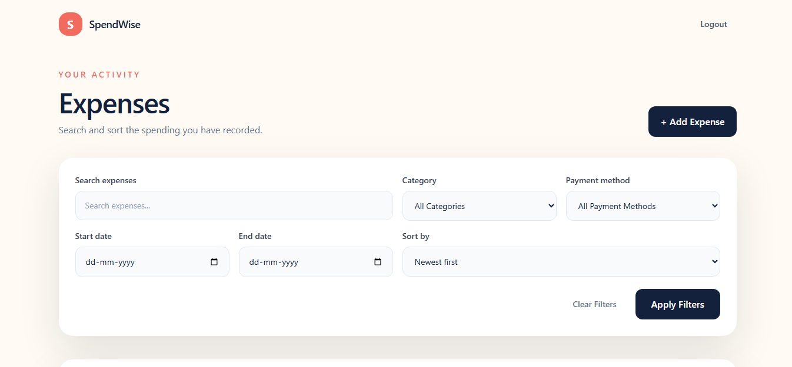
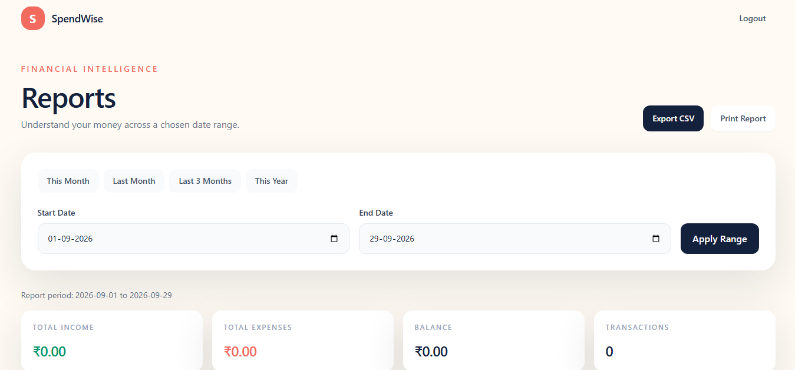
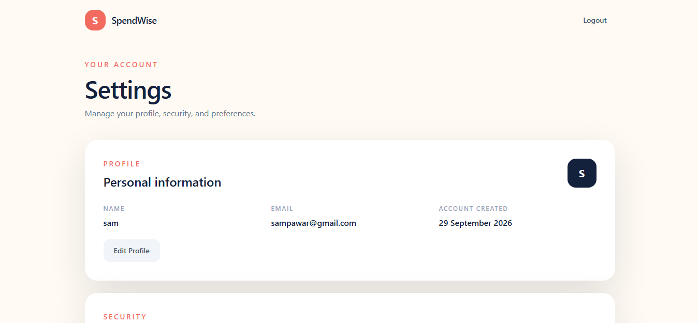

# SpendWise

**SpendWise** is a full-stack personal finance and budget tracker built with **FastAPI, React, and SQLite**.

It lets users manage expenses and income, set monthly budgets, analyze spending patterns, generate reports, and export transaction data — with authentication and strict user-level data isolation.

## Screenshots

### Dashboard



### Expenses



### Reports



### Settings



## Features

* JWT authentication with password hashing
* Profile and password management
* Expense and income management
* Monthly budget tracking
* Dashboard with spending analytics
* Category and monthly charts
* Backend-powered search, filtering, sorting, and pagination
* Custom date-range reports
* CSV transaction export
* Browser-friendly printable reports
* Light/dark theme
* Responsive React interface
* User data isolation
* Loading, empty, error, and toast states
* Automated backend tests

## Tech Stack

### Backend

* Python 3.12+
* FastAPI
* SQLAlchemy
* SQLite
* Pydantic
* JWT authentication
* Passlib / bcrypt
* pytest

### Frontend

* React
* Vite
* JavaScript
* Tailwind CSS
* React Router
* Recharts

## Architecture

SpendWise follows a simple frontend-backend architecture:

```text
React + Vite
     │
     │ HTTP / JSON
     ▼
FastAPI
     │
     ├── Authentication
     ├── Expenses
     ├── Income
     ├── Budgets
     ├── Dashboard
     ├── Reports
     └── User Settings
     │
     ▼
SQLAlchemy
     │
     ▼
SQLite
```

The backend keeps user-specific data isolated by associating expenses, income, and budgets with the authenticated user's ID.

More details are available in:

* `docs/architecture.md`
* `docs/interview-notes.md`

## Project Structure

```text
SpendWise/
├── backend/
│   ├── main.py
│   ├── database.py
│   ├── models.py
│   ├── schemas.py
│   ├── auth.py
│   ├── requirements.txt
│   ├── .env.example
│   ├── routes/
│   │   ├── auth.py
│   │   ├── budgets.py
│   │   ├── dashboard.py
│   │   ├── expenses.py
│   │   ├── income.py
│   │   ├── reports.py
│   │   └── users.py
│   └── tests/
│       ├── conftest.py
│       ├── test_auth.py
│       ├── test_budget.py
│       ├── test_expenses.py
│       ├── test_income.py
│       ├── test_reports.py
│       └── test_security.py
│
├── frontend/
│   ├── src/
│   │   ├── components/
│   │   ├── pages/
│   │   ├── services/
│   │   ├── App.jsx
│   │   └── main.jsx
│   ├── package.json
│   ├── .env.example
│   └── vite.config.js
│
├── docs/
│   ├── architecture.md
│   └── interview-notes.md
│
├── screenshots/
│   ├── dashboard.png
│   ├── expenses.png
│   ├── reports.png
│   └── settings.png
│
├── .gitignore
└── README.md
```

## Getting Started

### 1. Clone the repository

```powershell
git clone https://github.com/bh462007/SpendWise.git
cd SpendWise
```

### 2. Create the Python environment

```powershell
python -m venv .venv
.venv\Scripts\Activate.ps1
```

### 3. Install backend dependencies

```powershell
python -m pip install -r backend\requirements.txt
```

### 4. Configure the backend

Copy:

```text
backend/.env.example
```

to:

```text
backend/.env
```

Then set your local values:

```text
DATABASE_URL=sqlite:///./spendwise.db
SECRET_KEY=use-a-local-secret
ALGORITHM=HS256
```

### 5. Start FastAPI

Run this from the **SpendWise project root**:

```powershell
uvicorn backend.main:app --reload
```

Backend:

```text
http://127.0.0.1:8000
```

API documentation:

```text
http://127.0.0.1:8000/docs
```

### 6. Install frontend dependencies

Open another terminal:

```powershell
cd frontend
npm install
```

Copy:

```text
frontend/.env.example
```

to:

```text
frontend/.env
```

Then set:

```text
VITE_API_URL=http://127.0.0.1:8000
```

### 7. Start React

```powershell
npm run dev
```

Open:

```text
http://localhost:5173
```

## API Overview

### Authentication

```text
POST /auth/register
POST /auth/login
GET  /auth/me
```

### Profile & Settings

```text
GET    /users/me
PUT    /users/me
PUT    /users/me/password
DELETE /users/me
```

### Expenses

```text
POST   /expenses
GET    /expenses
GET    /expenses/{expense_id}
PUT    /expenses/{expense_id}
DELETE /expenses/{expense_id}
```

### Income

```text
POST   /income
GET    /income
GET    /income/{income_id}
PUT    /income/{income_id}
DELETE /income/{income_id}
```

### Budgets

```text
GET  /budgets
POST /budgets
PUT  /budgets/{budget_id}
```

### Dashboard

```text
GET /dashboard/summary
```

### Reports

```text
GET /reports/summary
GET /reports/categories
GET /reports/monthly
GET /reports/budget
GET /reports/export/csv
```

Expense and income list endpoints support backend search, filtering, sorting, and pagination.

Example:

```text
GET /expenses?category=Food&page=1&limit=10
```

## Testing

Run the backend test suite from the project root:

```powershell
python -m pytest
```

The test suite covers:

* Authentication
* Expense CRUD
* Income CRUD
* Budget handling
* Reports
* Filtering and pagination
* Security and user isolation

The tests use an isolated in-memory SQLite database and do not modify the application's `spendwise.db`.

### Frontend production build

```powershell
cd frontend
npm run build
```

## Security

* Passwords are hashed with bcrypt through Passlib and are never stored directly.
* JWT authentication protects private endpoints.
* JWT configuration is stored in environment variables.
* User-owned records are queried using the authenticated user's ID.
* Account deletion requires password confirmation.
* `.env` files and local databases are excluded from Git.
* Production secrets are not included in the repository.

## Future Improvements

* PostgreSQL for production deployments
* Database migrations
* Refresh tokens
* Recurring transactions
* Automated deployment
* Production monitoring

## Author

**Bhagyashree Pal**

Computer Engineering Student

GitHub: [@bh462007](https://github.com/bh462007)
